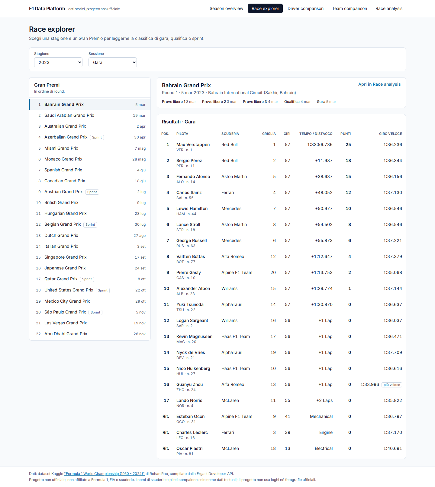
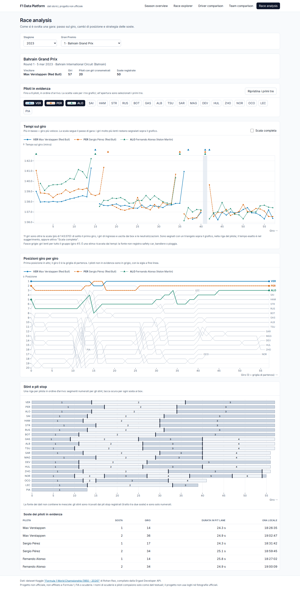

# F1 Data Platform

*End-to-end data pipeline and analytics platform for Formula 1 racing data.*

A data engineering and backend project: a reproducible pipeline takes the raw CSV files of a public dataset into a PostgreSQL relational model, a Spring Boot REST API computes standings and statistics on the database, and a web dashboard makes them explorable. The whole system starts with Docker Compose.

`Python · PostgreSQL · Java · Spring Boot · REST · JavaScript · Tailwind CSS · Docker`

## What it does

- **Ingestion and validation.** Reads the CSV files in Kaggle/Ergast format, converts missing-value markers to `NULL` and textual times to milliseconds, rejects invalid rows and records them in a report.
- **Intermediate format.** Writes deterministic Parquet files: two runs on the same input produce byte-identical files.
- **Idempotent load.** Loads the Parquet files into PostgreSQL with upserts in a single transaction; running it again creates no duplicates.
- **Relational model.** 12 tables created by 4 Flyway migrations, with keys, constraints and indexes designed for analytical queries.
- **REST API.** 15 read-only endpoints: calendar, race, qualifying and sprint classifications, laps, pit stops, stints, championship standings, driver and team statistics. Aggregations are computed in SQL, on the server.
- **Dashboard.** Five views (Season overview, Race explorer, Driver comparison, Team comparison, Race analysis) with filters and charts of lap times, positions, stints and pit stops.

The repository includes a sample dataset (seasons 2022–2024), so the system starts without access to the external source.

| | Sample dataset (2022–2024) | Full dataset (1950–2024) |
|---|---|---|
| Races | 68 | 1,125 |
| Race results | 1,359 | 26,759 |
| Sprint results | 300 | 360 |
| Timed laps | 74,489 | 589,081 |
| Pit stops (recorded since 2011) | 2,542 | 11,371 |
| Derived stints | 3,859 | 17,102 |
| Rows rejected by validation | 0 | 0 |
| Positions derived from `positionText` | 0 | 2 |

## Why it exists

The project demonstrates a complete path: from the raw data of an external source to a queryable analytical product. The subject is motor racing, but the content is the work on the data.

The source CSV files are not ready for analysis:

- missing values are written as `\N`, or as `0` (starting grid, fastest-lap rank);
- times and durations are text (`m:ss.mmm`), sometimes alongside a column in milliseconds and sometimes not;
- the race weekend is a single row with up to twelve date and time columns;
- race and sprint results live in two files with independent numbering;
- in historical seasons the race-driver pair is not unique (shared cars): 85 repeated pairs in `results.csv`;
- tyre compounds and stints are not there.

Each point required a modelling decision or a transformation rule, documented and covered by tests. The result is a database in which a statistic is obtained with a readable query, and an API whose values have been recomputed from the CSV files as a check.

## Architecture


| Compose service | Role | Host port |
|---|---|---|
| `postgres` | PostgreSQL 17 with the `postgres-data` volume | `POSTGRES_PORT` (5432) |
| `backend` | REST API; applies the migrations at startup | `API_PORT` (8080) |
| `pipeline` | loads the sample dataset and exits with code 0 | — |
| `frontend` | dashboard; its server forwards `/api` to the backend | `WEB_PORT` (8081) |

Startup order: `postgres` → `backend` (once the database is healthy) → `pipeline` and `frontend` (once the backend is healthy). The backend creates the schema, the pipeline populates it, the API reads it. Components, boundaries and verification are described in detail in [docs/architettura.md](docs/architettura.md).

The documents in `docs/` linked from this README are written in Italian.

## Pipeline

Python package `f1-pipeline` in [`data-pipeline/`](data-pipeline/), with five subcommands:

| Command | What it does |
|---|---|
| `download --output DIR` | downloads the dataset from Kaggle (requires the credentials in environment variables) |
| `sample --input DIR --output DIR --seasons ANNO...` | extracts the sample dataset from the full dataset, copying the original rows unchanged |
| `transform --input DIR --output DIR` | validates and normalises the CSV files; writes the Parquet files and the reports |
| `load --input DIR` | loads the Parquet files into PostgreSQL |
| `run [--source auto\|raw\|sample]` | picks the source, then runs `transform` and `load` |

Properties verified by the tests:

- **Reproducibility.** Rows sorted by key, write options and PyArrow version pinned, no metadata and no timestamps: same input, same checksums.
- **Idempotence.** `COPY` into temporary tables and `ON CONFLICT` upserts, in a single transaction; an error leaves no half-loaded data.
- **Declared validation.** Three reports next to the Parquet files: `scarti.json` (rejected rows, with file, row number and reason), `valori_annullati.json` (invalid optional attributes set to `NULL` without rejecting the row), `valori_derivati.json` (positions derived from `positionText`).
- **No row lost silently.** For every race in the sample, the number of results and laps in the database matches the CSV files, net of the recorded rejections.

Validation works row by row with the standard library `csv` module; PyArrow writes the Parquet files and psycopg 3 loads them. On the full dataset `transform` takes about 4 seconds and the first `load` about 20; on the sample the load takes a few seconds.

Transformation rules, file by file: [docs/modello-dati.md](docs/modello-dati.md#corrispondenza-csv--tabelle).

## Data model

The schema comes only from the migrations in [`database/migrations/`](database/migrations/) (V1–V4, 12 tables) and does not mirror the CSV files:

- the weekend is broken down into **sessions** (`fp1`, `fp2`, `fp3`, `qualifying`, `sprint`, `race`); classifications, laps and pit stops attach to the session through the composite key `(race_id, session_type)`;
- race and sprint results live in **a single table**, `results`, distinguished by session type;
- times and durations are **integers in milliseconds**; the redundant text columns do not exist;
- `positionText` becomes the `outcome` column, and a `CHECK` constraint requires a position if and only if the outcome is `classified`;
- championship standings are not stored: they are derived from the results;
- `stints` is **derived from the pit stops** (a stretch between two stops), with `compound` always `NULL` because the source does not contain tyre compounds.

Tables: `seasons`, `circuits`, `drivers`, `constructors`, `statuses`, `races`, `sessions`, `results`, `qualifying_results`, `laps`, `pit_stops`, `stints`.

ER diagram, rationale for keys, types and indexes, and the outcome of checking the assumptions against the full dataset: [docs/modello-dati.md](docs/modello-dati.md).

## API

Spring Boot 3 on Java 21, data access with `JdbcClient` and explicit SQL. JSON responses in camelCase; the identifiers of races, drivers, teams and circuits are those of the source.

- Interactive documentation: <http://localhost:8080/swagger-ui.html>
- OpenAPI specification: <http://localhost:8080/v3/api-docs>

| Endpoint | Response |
|---|---|
| `GET /api/seasons` | seasons with at least one loaded race, most recent first |
| `GET /api/seasons/{year}/races` | season calendar, with circuit, winner and whether there is a sprint |
| `GET /api/seasons/{year}/drivers` | drivers with at least one race result in the season, with their teams |
| `GET /api/seasons/{year}/teams` | teams with at least one race result in the season |
| `GET /api/seasons/{year}/standings/drivers` | driver standings computed from the results (races plus sprints) |
| `GET /api/seasons/{year}/standings/teams` | team standings computed from the results (races plus sprints) |
| `GET /api/races/{raceId}` | race detail: season, round, date, circuit, sessions |
| `GET /api/races/{raceId}/results[?session=race\|sprint]` | classification in finishing order; without the parameter, the race only |
| `GET /api/races/{raceId}/qualifying` | qualifying classification with the Q1, Q2, Q3 times in milliseconds |
| `GET /api/races/{raceId}/laps` | laps of all drivers, grouped by driver |
| `GET /api/races/{raceId}/laps/{driverId}` | laps of one driver, with position and time in milliseconds |
| `GET /api/races/{raceId}/pit-stops` | pit stops in lap order |
| `GET /api/races/{raceId}/stints` | stints derived from the pit stops (`compound` always `null`) |
| `GET /api/drivers/{driverId}/statistics[?season=YYYY]` | races, starts, wins, podiums, points and averages for a driver |
| `GET /api/teams/{teamId}/statistics[?season=YYYY]` | the same statistics for a team, across all its cars |

Conventions:

- **Errors** share a single body, `{status, error, message, path, timestamp}`: 404 for a race, season, driver or team that does not exist; 400 for invalid parameters (`session` other than `race` and `sprint`, non-positive `season`).
- **Statistics**: they count races only. `races` are the Grands Prix in which the driver or team appears in the classification, `starts` the race starts; `points` are the points from races and `sprintPoints` those from sprints (the championship total is their sum). For a team, `podiums` counts podium finishes, so it can exceed `races`.
- **Championship standings**: computed from the loaded results, without penalties or historical best-results rules; for some seasons they may differ from the official ones.
- **Response times** on the sample dataset: a median of a few milliseconds per endpoint; the acceptance test threshold is 500 ms.

## Dashboard

HTML, CSS and ES modules with no framework and no bundler, Tailwind CSS v4, SVG charts with Observable Plot. The browser talks only to the frontend server, which serves the static files and forwards `/api` to the backend: no CORS and no API URL in the code. The charting library and the fonts are served locally, without a CDN.

Each series in a chart has its own colour, dash pattern and marker; loading, empty list, data absent from the source and API error each have an explicit message. The dashboard interface text is in Italian. Palette, typography, chart rules and layout: [docs/direzione-ui.md](docs/direzione-ui.md).

## Run locally

Requirements: Docker with Compose.

```bash
cp .env.example .env
# fill in POSTGRES_DB, POSTGRES_USER and POSTGRES_PASSWORD in .env
docker compose up --build
```

The three database variables have no default values, by design: if they are missing, Compose stops immediately with an explicit message instead of starting a database with known credentials. The `.env` file is not versioned.

Compose builds the images, starts `postgres`, `backend` and `frontend`, then runs `pipeline`, which loads the sample dataset and exits with code 0.

| What | Address |
|---|---|
| Dashboard | <http://localhost:8081> |
| API | <http://localhost:8080/api/seasons> |
| Swagger UI | <http://localhost:8080/swagger-ui.html> |

The ports published on the host can be changed with `POSTGRES_PORT`, `API_PORT` and `WEB_PORT`, in the environment or in `.env`.

### Full dataset (optional)

A Kaggle account is required. The credentials go in `.env`, in the `KAGGLE_API_TOKEN` variable or in the `KAGGLE_USERNAME` and `KAGGLE_KEY` pair. Then:

```bash
docker compose run --rm pipeline download --output /data/raw
docker compose run --rm pipeline run --source raw
```

The first command downloads the CSV files into `data-pipeline/raw/`; the second transforms them (intermediate files in `data-pipeline/processed/`) and loads them. Both directories are ignored by git.

### Verification

```bash
./verifica.sh
```

Requires Docker, `jq`, `git` and Java 21. It works on a clean copy of the repository and on an isolated Docker stack, with its own Compose project, volumes, ports and credentials: it does not use `.env` and does not touch a stack started by hand. It runs:

1. the backend tests: 176, JUnit with Testcontainers, on the sample loaded by the real pipeline;
2. the pipeline tests: 165 (5 require a dedicated database, given in `F1_PIPELINE_TEST_DSN`, and are skipped without it);
3. the 38 acceptance tests on pipeline, database, API, dashboard (Playwright), Docker and repository;
4. the dashboard screenshots, saved in `review/`.

The 72 frontend tests run during the build of its Docker image: if one fails, the image is not created.

## Screenshots

Regenerated by `./verifica.sh` on the sample dataset.

**Season overview**: key figures, calendar with winners, driver and constructor standings.


**Race explorer**: races of the season, race card and results of the selected session.



**Race analysis**: lap times, positions, stints and pit stops.



**Driver comparison**: statistics of two drivers and a comparison within one race.


## API request examples

Real responses on the sample dataset, shortened with `...`. The API's error messages are in Italian and are shown here as returned.

Available seasons:

```bash
curl http://localhost:8080/api/seasons
```

```json
[
  {"year": 2024, "races": 24, "sprints": 6, "firstRaceDate": "2024-03-02", "lastRaceDate": "2024-12-08"},
  ...
]
```

Statistics of a driver in a season:

```bash
curl "http://localhost:8080/api/drivers/830/statistics?season=2023"
```

```json
{
  "driver": {"id": 830, "code": "VER", "name": "Max Verstappen", ...},
  "season": 2023,
  "races": 22,
  "starts": 22,
  "wins": 19,
  "podiums": 21,
  "points": 530.0,
  "sprintPoints": 45.0,
  "poles": 12,
  "fastestLaps": 9,
  ...
}
```

Team standings of a season (first element):

```bash
curl http://localhost:8080/api/seasons/2023/standings/teams
```

```json
[
  {
    "position": 1,
    "team": {"id": 9, "name": "Red Bull", "nationality": "Austrian"},
    "points": 860.0,
    "racePoints": 790.0,
    "sprintPoints": 70.0,
    "wins": 21,
    "podiums": 30
  },
  ...
]
```

Resource that does not exist (HTTP 404):

```bash
curl http://localhost:8080/api/races/999999999
```

```json
{
  "status": 404,
  "error": "Not Found",
  "message": "Gara 999999999 inesistente",
  "path": "/api/races/999999999",
  "timestamp": "..."
}
```

## Technical decisions and trade-offs

The full log, with the alternatives that were rejected, is in [docs/decisioni.md](docs/decisioni.md). The choices that carry the most weight:

| Decision | Reason | Cost |
|---|---|---|
| The backend creates the schema (Flyway); the pipeline only loads | a single owner of the schema, released together with the queries that depend on it | a startup order: backend first, then the pipeline |
| Explicit SQL with `JdbcClient`, no JPA | standings and statistics are aggregations; the entities of an ORM would never be exposed | hand-written mapping to DTOs |
| `csv` module and PyArrow, no dataframes | validation records the row number and reason of every rejection | more code than with a dataframe library |
| Identifiers inherited from the source | same input, same `id` values in every database: stable URLs and expected values that can be computed by hand | a second source would require reconciliation on natural keys |
| Races and sprints in the same table | same grain and same columns; no `UNION` for the points of a weekend | every query has to filter on the session type |
| Stints derived from the pit stops | race strategy can be derived reliably from the stops | a stint is "the stretch between two visits to the pits", not "the stretch on the same tyres" |
| Frontend with no framework and no bundler, Node server with no dependencies | the browser loads the modules as they are; same server in development and in the container | no reusable components from an ecosystem |
| Credentials with no default values | the system never starts with known credentials | a manual step (`.env`) before the first start |

Known limitations:

- **No tyre compounds.** The source does not contain them: stints have no compound, and the dashboard states this next to the chart.
- **Data up to the 2024 season.** The original source has been discontinued; later seasons are not there.
- **The load does not remove rows that have disappeared from the input.** The upsert updates and inserts; on an already populated database, reloading a reduced input leaves the previous rows in place (only `stints` is replaced). Compose and `verifica.sh` start from an empty volume.
- **Unofficial standings.** They are the sum of the loaded points; the data is not verified against the official results.
- **Out of scope for this version**: public deployment, authentication, real-time data.

## Repository structure

```text
data-pipeline/        Python pipeline (src/, tests/) and sample dataset (sample/)
database/migrations/  Flyway migrations V1-V4
backend/              Spring Boot API
frontend/             dashboard and Node server
docs/                 architecture, data model, data source, UI direction, decisions
tests/accettazione/   acceptance tests
config/               acceptance test thresholds
review/               dashboard screenshots
docker-compose.yml    local orchestration
verifica.sh           full verification
```

## Data Source & Acknowledgements

The data comes from the [Formula 1 World Championship (1950 - 2024)](https://www.kaggle.com/datasets/rohanrao/formula-1-world-championship-1950-2020)
dataset by Rohan Rao, published on Kaggle under the CC0: Public Domain licence and compiled from the
[Ergast Developer API](http://ergast.com/mrd/). Thanks to both for making this data available.
Details on licence and provenance: [docs/fonte-dati.md](docs/fonte-dati.md).

The CC0 licence is the one declared on Kaggle; the original Ergast terms, which intended the data for non-commercial use, can no longer be consulted. The point is described in [docs/fonte-dati.md](docs/fonte-dati.md#punto-aperto-i-termini-originali-di-ergast). The repository redistributes only the sample dataset.

### Third-party libraries

The dashboard bundles and serves locally, with their respective licence files: [Observable Plot](https://observablehq.com/plot/) and [D3](https://d3js.org/) (ISC licence), the [Inter](https://rsms.me/inter/) typeface (SIL Open Font License 1.1); the styles are generated with [Tailwind CSS](https://tailwindcss.com/) (MIT licence).

## How it works

The project was developed with Claude Code as a team of specialised agents (data architect, pipeline, backend and frontend developers, technical writers, reviewer), coordinated by a main agent. Acceptance tests were written and approved first, then locked by hooks so no agent could edit them; every milestone closed only after the reviewer's sign-off. The setup lives in `CLAUDE.md` and `.claude/`, the original brief in `f1-data-platform-brief-claude-code.md`, the milestone log in `PROGESS.md` (these working files are in Italian).

## Disclaimer

F1 Data Platform is an unofficial project, not affiliated with Formula 1, the FIA or any team.
Team and driver names appear only as textual data; the project uses no official logos or photographs. "F1" and "Formula 1" are trademarks of their respective owners.

## Copyright

© 2026 Luca Monaco. All rights reserved. Proprietary software: no licence to use, copy or distribute it is granted. This notice covers the code, not the data.
