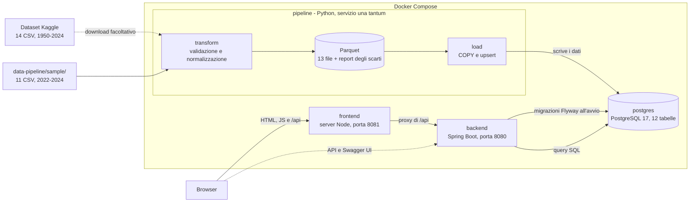
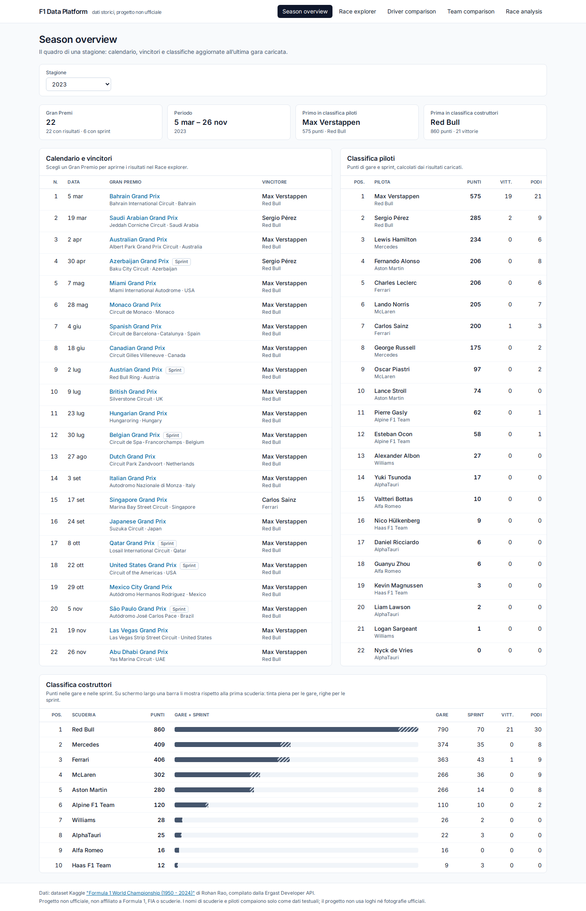
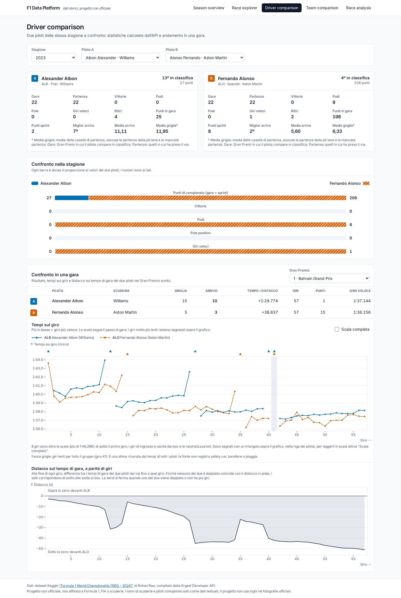

# F1 Data Platform

*End-to-end data pipeline and analytics platform for Formula 1 racing data.*

Progetto di data engineering e backend: una pipeline riproducibile porta i CSV grezzi di un dataset pubblico in un modello relazionale PostgreSQL, un'API REST Spring Boot calcola classifiche e statistiche sul database, una dashboard web le rende esplorabili. Tutto il sistema si avvia con Docker Compose.

`Python · PostgreSQL · Java · Spring Boot · REST · JavaScript · Tailwind CSS · Docker`

## Cosa fa

- **Ingestione e validazione.** Legge i CSV in formato Kaggle/Ergast, converte i marcatori di valore mancante in `NULL` e i tempi testuali in millisecondi, scarta le righe non valide e le registra in un report.
- **Formato intermedio.** Scrive file Parquet deterministici: due esecuzioni sullo stesso input producono file identici al byte.
- **Caricamento idempotente.** Carica i Parquet in PostgreSQL con upsert in una sola transazione; rieseguirlo non crea duplicati.
- **Modello relazionale.** 12 tabelle create da 4 migrazioni Flyway, con chiavi, vincoli e indici pensati per le query analitiche.
- **API REST.** 15 endpoint di sola lettura: calendario, classifiche di gara, qualifica e sprint, giri, pit stop, stint, classifiche di campionato, statistiche di piloti e scuderie. Le aggregazioni si calcolano in SQL, lato server.
- **Dashboard.** Cinque viste (Season overview, Race explorer, Driver comparison, Team comparison, Race analysis) con filtri e grafici di tempi sul giro, posizioni, stint e pit stop.

Il repository include un dataset di esempio (stagioni 2022–2024), quindi il sistema si avvia senza accesso alla fonte esterna.

| | Dataset di esempio (2022–2024) | Dataset completo (1950–2024) |
|---|---|---|
| Gare | 68 | 1 125 |
| Risultati di gara | 1 359 | 26 759 |
| Risultati di sprint | 300 | 360 |
| Giri cronometrati | 74 489 | 589 081 |
| Pit stop (registrati dal 2011) | 2 542 | 11 371 |
| Stint derivati | 3 859 | 17 102 |
| Righe scartate dalla validazione | 0 | 0 |
| Posizioni derivate da `positionText` | 0 | 2 |

## Perché esiste

Il progetto dimostra un percorso completo: da dati grezzi di una fonte esterna a un prodotto analitico interrogabile. L'argomento sono le corse, ma il contenuto è il lavoro sui dati.

I CSV di partenza non sono pronti per l'analisi:

- i valori mancanti sono scritti come `\N`, oppure come `0` (griglia di partenza, rango del giro veloce);
- tempi e durate sono testo (`m:ss.mmm`), a volte affiancati da una colonna in millisecondi e a volte no;
- il weekend di gara è una riga sola con fino a dodici colonne di date e orari;
- i risultati di gara e di sprint stanno in due file con numerazioni indipendenti;
- nelle stagioni storiche la coppia gara-pilota non è univoca (vetture condivise): 85 coppie ripetute in `results.csv`;
- mescole e stint non ci sono.

Ogni punto ha richiesto una decisione di modellazione o una regola di trasformazione, documentata e coperta da test. Il risultato è un database in cui una statistica si ottiene con una query leggibile, e un'API i cui valori sono stati ricalcolati dai CSV per controllo.

## Architettura



| Servizio Compose | Ruolo | Porta sull'host |
|---|---|---|
| `postgres` | PostgreSQL 17 con volume `postgres-data` | `POSTGRES_PORT` (5432) |
| `backend` | API REST; all'avvio applica le migrazioni | `API_PORT` (8080) |
| `pipeline` | carica il dataset di esempio e termina con codice 0 | — |
| `frontend` | dashboard; il suo server inoltra `/api` al backend | `WEB_PORT` (8081) |

Ordine di avvio: `postgres` → `backend` (quando il database è healthy) → `pipeline` e `frontend` (quando il backend è healthy). Lo schema lo crea il backend, la pipeline lo popola, l'API lo legge. Il dettaglio di componenti, confini e verifica è in [docs/architettura.md](docs/architettura.md).

## Pipeline

Pacchetto Python `f1-pipeline` in [`data-pipeline/`](data-pipeline/), con cinque sottocomandi:

| Comando | Che cosa fa |
|---|---|
| `download --output DIR` | scarica il dataset da Kaggle (richiede le credenziali nelle variabili d'ambiente) |
| `sample --input DIR --output DIR --seasons ANNO...` | estrae dal dataset completo il dataset di esempio, ricopiando le righe originali |
| `transform --input DIR --output DIR` | valida e normalizza i CSV; scrive i Parquet e i report |
| `load --input DIR` | carica i Parquet in PostgreSQL |
| `run [--source auto\|raw\|sample]` | sceglie la sorgente, poi esegue `transform` e `load` |

Proprietà verificate dai test:

- **Riproducibilità.** Righe ordinate per chiave, opzioni di scrittura e versione di PyArrow fissate, nessun metadato né timestamp: stesso input, stessi checksum.
- **Idempotenza.** `COPY` verso tabelle temporanee e upsert `ON CONFLICT`, in una sola transazione; un errore non lascia dati a metà.
- **Validazione dichiarata.** Tre report accanto ai Parquet: `scarti.json` (righe scartate, con file, numero di riga e motivo), `valori_annullati.json` (attributi facoltativi non validi messi a `NULL` senza scartare la riga), `valori_derivati.json` (posizioni ricavate da `positionText`).
- **Nessuna riga persa in silenzio.** Per ogni gara del campione il numero di risultati e di giri nel database coincide con quello dei CSV, al netto degli scarti registrati.

La validazione lavora riga per riga con il modulo `csv` della libreria standard; PyArrow scrive i Parquet e psycopg 3 carica. Sul dataset completo `transform` impiega circa 4 secondi e il primo `load` circa 20; sul campione il caricamento dura pochi secondi.

Regole di trasformazione, file per file: [docs/modello-dati.md](docs/modello-dati.md#corrispondenza-csv--tabelle).

## Modello dati

Lo schema nasce solo dalle migrazioni in [`database/migrations/`](database/migrations/) (V1–V4, 12 tabelle) e non ricalca i CSV:

- il weekend è scomposto in **sessioni** (`fp1`, `fp2`, `fp3`, `qualifying`, `sprint`, `race`); classifiche, giri e soste si agganciano alla sessione con la chiave composta `(race_id, session_type)`;
- risultati di gara e di sprint stanno in **una sola tabella** `results`, distinti dal tipo di sessione;
- tempi e durate sono **interi in millisecondi**; le colonne testuali ridondanti non esistono;
- `positionText` diventa la colonna `outcome`, e un vincolo `CHECK` impone una posizione se e solo se l'esito è `classified`;
- le classifiche di campionato non sono memorizzate: si ricavano dai risultati;
- `stints` è **derivata dai pit stop** (un tratto tra due soste), con `compound` sempre `NULL` perché la fonte non contiene le mescole.

Tabelle: `seasons`, `circuits`, `drivers`, `constructors`, `statuses`, `races`, `sessions`, `results`, `qualifying_results`, `laps`, `pit_stops`, `stints`.

Diagramma ER, motivazioni di chiavi, tipi e indici, ed esito della verifica delle assunzioni sul dataset completo: [docs/modello-dati.md](docs/modello-dati.md).

## API

Spring Boot 3 su Java 21, accesso ai dati con `JdbcClient` e SQL esplicito. Risposte JSON in camelCase; gli identificativi di gare, piloti, scuderie e circuiti sono quelli della fonte.

- Documentazione interattiva: <http://localhost:8080/swagger-ui.html>
- Specifica OpenAPI: <http://localhost:8080/v3/api-docs>

| Endpoint | Risposta |
|---|---|
| `GET /api/seasons` | stagioni con almeno una gara caricata, dalla più recente |
| `GET /api/seasons/{year}/races` | calendario della stagione, con circuito, vincitore e presenza della sprint |
| `GET /api/seasons/{year}/drivers` | piloti con almeno un risultato di gara nella stagione, con le loro scuderie |
| `GET /api/seasons/{year}/teams` | scuderie con almeno un risultato di gara nella stagione |
| `GET /api/seasons/{year}/standings/drivers` | classifica piloti calcolata dai risultati (gare più sprint) |
| `GET /api/seasons/{year}/standings/teams` | classifica scuderie calcolata dai risultati (gare più sprint) |
| `GET /api/races/{raceId}` | dettaglio della gara: stagione, round, data, circuito, sessioni |
| `GET /api/races/{raceId}/results[?session=race\|sprint]` | classifica in ordine di arrivo; senza parametro, solo la gara |
| `GET /api/races/{raceId}/qualifying` | classifica della qualifica con i tempi di Q1, Q2, Q3 in millisecondi |
| `GET /api/races/{raceId}/laps` | giri di tutti i piloti, raggruppati per pilota |
| `GET /api/races/{raceId}/laps/{driverId}` | giri di un pilota, con posizione e tempo in millisecondi |
| `GET /api/races/{raceId}/pit-stops` | soste ai box in ordine di giro |
| `GET /api/races/{raceId}/stints` | stint derivati dai pit stop (`compound` sempre `null`) |
| `GET /api/drivers/{driverId}/statistics[?season=YYYY]` | gare, partenze, vittorie, podi, punti e medie di un pilota |
| `GET /api/teams/{teamId}/statistics[?season=YYYY]` | le stesse statistiche per una scuderia, su tutte le sue vetture |

Convenzioni:

- **Errori** con un corpo unico `{status, error, message, path, timestamp}`: 404 per gara, stagione, pilota o scuderia inesistente; 400 per parametri non validi (`session` diverso da `race` e `sprint`, `season` non positivo).
- **Statistiche**: contano le sole gare. `races` sono i Gran Premi in cui si compare in classifica, `starts` le partenze; `points` sono i punti delle gare e `sprintPoints` quelli delle sprint (il totale di campionato è la somma). Per una scuderia `podiums` conta i piazzamenti, quindi può superare `races`.
- **Classifiche di campionato**: calcolate dai risultati caricati, senza penalizzazioni né regole storiche sui migliori risultati; per alcune stagioni possono differire da quelle ufficiali.
- **Tempi di risposta** sul dataset di esempio: mediana di pochi millisecondi per endpoint; la soglia dei test di accettazione è 500 ms.

## Dashboard

HTML, CSS e moduli ES senza framework né bundler, Tailwind CSS v4, grafici SVG con Observable Plot. Il browser parla solo con il server del frontend, che serve i file statici e inoltra `/api` al backend: nessun CORS e nessun URL dell'API nel codice. Libreria dei grafici e caratteri sono serviti in locale, senza CDN.

Ogni serie di un grafico ha colore, tratteggio e marcatore propri; caricamento, lista vuota, dato assente nella fonte ed errore dell'API hanno ciascuno un messaggio esplicito. Palette, tipografia, regole dei grafici e layout: [docs/direzione-ui.md](docs/direzione-ui.md).

## Avvio locale

Requisiti: Docker con Compose.

```bash
cp .env.example .env
# compila POSTGRES_DB, POSTGRES_USER e POSTGRES_PASSWORD in .env
docker compose up --build
```

Le tre variabili del database non hanno valori predefiniti, per scelta: se mancano, Compose si ferma subito con un messaggio esplicito invece di avviare un database con credenziali note. Il file `.env` non è versionato.

Compose costruisce le immagini, avvia `postgres`, `backend` e `frontend`, poi esegue `pipeline`, che carica il dataset di esempio e termina con codice 0.

| Che cosa | Indirizzo |
|---|---|
| Dashboard | <http://localhost:8081> |
| API | <http://localhost:8080/api/seasons> |
| Swagger UI | <http://localhost:8080/swagger-ui.html> |

Le porte pubblicate sull'host si cambiano con `POSTGRES_PORT`, `API_PORT` e `WEB_PORT`, nell'ambiente o in `.env`.

### Dataset completo (facoltativo)

Serve un account Kaggle. Le credenziali vanno in `.env`, nella variabile `KAGGLE_API_TOKEN` oppure nella coppia `KAGGLE_USERNAME` e `KAGGLE_KEY`. Poi:

```bash
docker compose run --rm pipeline download --output /data/raw
docker compose run --rm pipeline run --source raw
```

Il primo comando scarica i CSV in `data-pipeline/raw/`, il secondo li trasforma (file intermedi in `data-pipeline/processed/`) e li carica. Entrambe le cartelle sono ignorate da git.

### Verifica

```bash
./verifica.sh
```

Richiede Docker, `jq`, `git` e Java 21. Lavora su una copia pulita del repository e su uno stack Docker isolato, con progetto Compose, volumi, porte e credenziali propri: non usa `.env` e non tocca lo stack avviato a mano. Esegue:

1. i test del backend: 176, JUnit con Testcontainers, sul campione caricato dalla pipeline vera;
2. i test della pipeline: 165 (5 richiedono un database dedicato, indicato da `F1_PIPELINE_TEST_DSN`, e senza vengono saltati);
3. i 38 test di accettazione su pipeline, database, API, dashboard (Playwright), Docker e repository;
4. gli screenshot della dashboard, salvati in `review/`.

I 54 test del frontend girano durante la build della sua immagine Docker: se uno fallisce, l'immagine non si crea.

## Screenshot

Rigenerati da `./verifica.sh` sul dataset di esempio.

**Season overview**: indicatori, calendario con vincitori, classifiche piloti e costruttori.



**Race explorer**: gare della stagione, scheda della gara e risultati della sessione scelta.


**Race analysis**: tempi sul giro, posizioni, stint e pit stop.


**Driver comparison**: statistiche di due piloti e confronto in una gara.



## Esempi di richieste API

Risposte reali sul dataset di esempio, abbreviate con `...`.

Stagioni disponibili:

```bash
curl http://localhost:8080/api/seasons
```

```json
[
  {"year": 2024, "races": 24, "sprints": 6, "firstRaceDate": "2024-03-02", "lastRaceDate": "2024-12-08"},
  ...
]
```

Statistiche di un pilota in una stagione:

```bash
curl "http://localhost:8080/api/drivers/830/statistics?season=2023"
```

```json
{
  "driver": {"id": 830, "code": "VER", "name": "Max Verstappen", ...},
  "season": 2023,
  "races": 22,
  "starts": 22,
  "wins": 19,
  "podiums": 21,
  "points": 530.0,
  "sprintPoints": 45.0,
  "poles": 12,
  "fastestLaps": 9,
  ...
}
```

Classifica scuderie di una stagione (primo elemento):

```bash
curl http://localhost:8080/api/seasons/2023/standings/teams
```

```json
[
  {
    "position": 1,
    "team": {"id": 9, "name": "Red Bull", "nationality": "Austrian"},
    "points": 860.0,
    "racePoints": 790.0,
    "sprintPoints": 70.0,
    "wins": 21,
    "podiums": 30
  },
  ...
]
```

Risorsa inesistente (HTTP 404):

```bash
curl http://localhost:8080/api/races/999999999
```

```json
{
  "status": 404,
  "error": "Not Found",
  "message": "Gara 999999999 inesistente",
  "path": "/api/races/999999999",
  "timestamp": "..."
}
```

## Decisioni tecniche e compromessi

Il registro completo, con le alternative scartate, è in [docs/decisioni.md](docs/decisioni.md). Le scelte che pesano di più:

| Decisione | Motivo | Prezzo |
|---|---|---|
| Lo schema lo crea il backend (Flyway), la pipeline carica soltanto | un solo proprietario dello schema, rilasciato insieme alle query che ne dipendono | un ordine di avvio: prima il backend, poi la pipeline |
| SQL esplicito con `JdbcClient`, niente JPA | classifiche e statistiche sono aggregazioni; le entità di un ORM non verrebbero mai esposte | mappatura su DTO scritta a mano |
| Modulo `csv` e PyArrow, niente dataframe | la validazione registra numero di riga e motivo di ogni scarto | più codice rispetto a una libreria di dataframe |
| Identificativi ereditati dalla fonte | stesso input, stessi `id` in ogni database: URL stabili e valori attesi calcolabili a mano | una seconda fonte richiederebbe una riconciliazione sulle chiavi naturali |
| Gare e sprint nella stessa tabella | stessa grana e stesse colonne; nessuna `UNION` per i punti di un weekend | ogni query deve filtrare il tipo di sessione |
| Stint derivati dai pit stop | la strategia di gara si ricava in modo affidabile dalle soste | uno stint è "tratto tra due passaggi ai box", non "tratto con le stesse gomme" |
| Frontend senza framework né bundler, server Node senza dipendenze | il browser carica i moduli così come sono; stesso server in sviluppo e nel container | nessun componente riusabile da un ecosistema |
| Credenziali senza valori predefiniti | il sistema non parte mai con credenziali note | un passo manuale (`.env`) prima del primo avvio |

Limiti noti:

- **Niente mescole.** La fonte non le contiene: gli stint non hanno mescola e la dashboard lo dichiara accanto al grafico.
- **Dati fino alla stagione 2024.** La fonte originale è dismessa; le stagioni successive non ci sono.
- **Il caricamento non rimuove le righe sparite dall'input.** L'upsert aggiorna e inserisce; su un database già popolato, ricaricare un input ridotto lascia le righe precedenti (solo `stints` viene sostituita). Compose e `verifica.sh` partono da un volume vuoto.
- **Classifiche non ufficiali.** Sono la somma dei punti caricati; i dati non sono verificati rispetto ai risultati ufficiali.
- **Fuori dallo scopo di questo step**: deploy pubblico, autenticazione, dati in tempo reale.

## Struttura del repository

```text
data-pipeline/        pipeline Python (src/, tests/) e dataset di esempio (sample/)
database/migrations/  migrazioni Flyway V1-V4
backend/              API Spring Boot
frontend/             dashboard e server Node
docs/                 architettura, modello dati, fonte dati, direzione UI, decisioni
tests/accettazione/   test di accettazione
config/               soglie dei test di accettazione
review/               screenshot della dashboard
docker-compose.yml    orchestrazione locale
verifica.sh           verifica completa
```

## Data Source & Acknowledgements

I dati provengono dal dataset [Formula 1 World Championship (1950 - 2024)](https://www.kaggle.com/datasets/rohanrao/formula-1-world-championship-1950-2020)
di Rohan Rao, pubblicato su Kaggle con licenza CC0: Public Domain e compilato a partire dalla
[Ergast Developer API](http://ergast.com/mrd/). Grazie a entrambi per aver reso disponibili questi dati.
Dettagli su licenza e provenienza: [docs/fonte-dati.md](docs/fonte-dati.md).

La licenza CC0 è quella dichiarata su Kaggle; i termini originali di Ergast, che destinava i dati a usi non commerciali, non sono più consultabili. Il punto è descritto in [docs/fonte-dati.md](docs/fonte-dati.md#punto-aperto-i-termini-originali-di-ergast). Il repository ridistribuisce solo il dataset di esempio.

### Librerie di terze parti

La dashboard include e serve in locale, con i rispettivi file di licenza: [Observable Plot](https://observablehq.com/plot/) e [D3](https://d3js.org/) (licenza ISC), il carattere [Inter](https://rsms.me/inter/) (SIL Open Font License 1.1); gli stili sono generati con [Tailwind CSS](https://tailwindcss.com/) (licenza MIT).

## Disclaimer

F1 Data Platform è un progetto non ufficiale, non affiliato a Formula 1, FIA o scuderie.
I nomi di scuderie e piloti compaiono solo come dati testuali; il progetto non usa loghi né fotografie ufficiali. "F1" e "Formula 1" sono marchi dei rispettivi proprietari.

## Copyright

© 2026 Luca Monaco. Tutti i diritti riservati. Software proprietario: nessuna licenza d'uso, copia o distribuzione è concessa. La nota riguarda il codice, non i dati.
