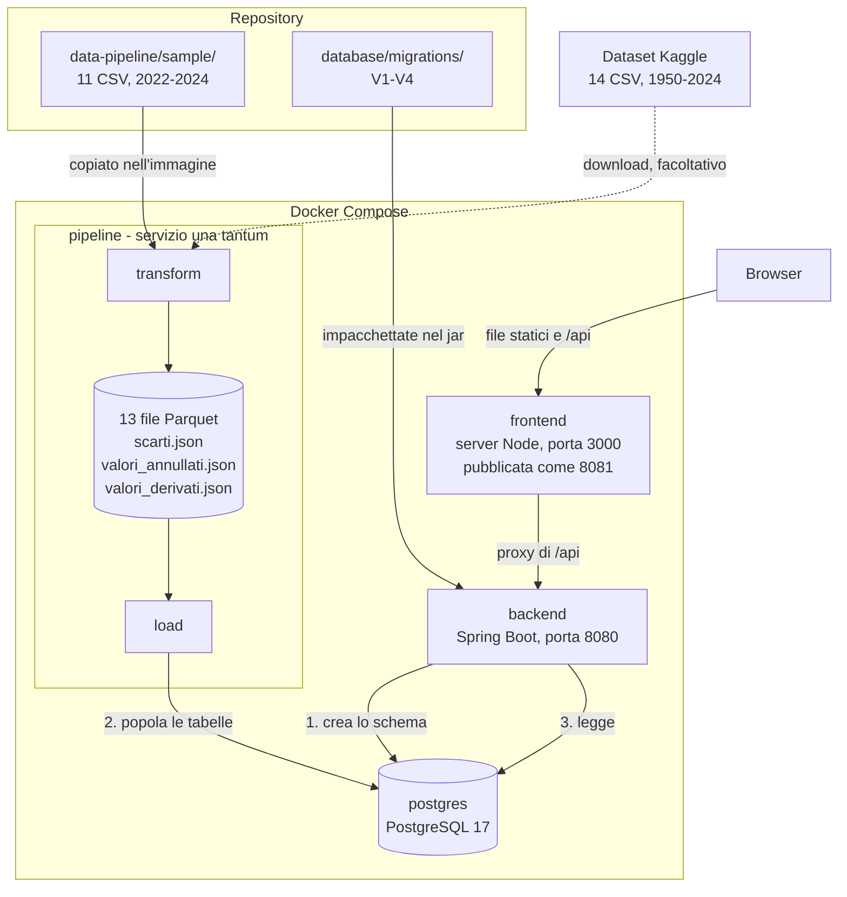
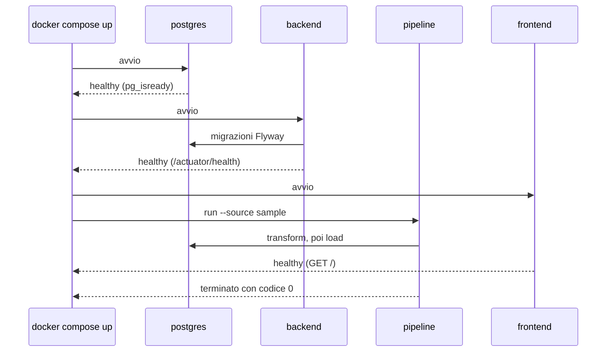

# Architettura

Come è fatto F1 Data Platform: quali componenti ci sono, che cosa fa ciascuno, come i dati passano dal CSV alla dashboard e come il sistema viene verificato.

Questo documento descrive la struttura. Il resto è altrove:

| Argomento | Documento |
|---|---|
| Schema, regole di trasformazione, query | [`modello-dati.md`](modello-dati.md) |
| Scelte tecniche e alternative scartate | [`decisioni.md`](decisioni.md) |
| Fonte, licenza e attribuzione dei dati | [`fonte-dati.md`](fonte-dati.md) |
| Aspetto e regole della dashboard | [`direzione-ui.md`](direzione-ui.md) |
| Interfacce fissate dai test di accettazione | [`../tests/accettazione/README.md`](../tests/accettazione/README.md) |

## Componenti

| Componente | Cartella | Tecnologia | Responsabilità |
|---|---|---|---|
| Pipeline dati | `data-pipeline/` | Python 3.12, PyArrow, psycopg 3 | scaricare i CSV, estrarre il campione, validare e normalizzare, scrivere i Parquet e i report, caricare in PostgreSQL |
| Schema | `database/migrations/` | SQL, Flyway | definire le 12 tabelle con chiavi, vincoli e indici (V1–V4) |
| Database | servizio `postgres` | PostgreSQL 17 | conservare i dati; far rispettare i vincoli |
| Backend | `backend/` | Java 21, Spring Boot 3, `JdbcClient` | applicare le migrazioni all'avvio; esporre l'API REST di sola lettura; calcolare classifiche e statistiche in SQL |
| Frontend | `frontend/` | HTML, CSS, moduli ES, Tailwind CSS v4, Observable Plot; server Node | servire la dashboard; inoltrare `/api` al backend |
| Orchestrazione | `docker-compose.yml` | Docker Compose | avviare i servizi nell'ordine giusto e lanciare il caricamento del campione |
| Verifica | `verifica.sh`, `tests/accettazione/` | Bash, pytest, Playwright | provare il sistema dall'esterno, su una copia pulita e uno stack isolato |

## Diagramma

## Flusso dei dati

1. **Sorgente.** I CSV sono quelli del dataset Kaggle, nel formato originale. `docker compose up` usa il dataset di esempio, copiato nell'immagine della pipeline (`/app/sample`). Il dataset completo, facoltativo, si scarica con `f1-pipeline download` in `data-pipeline/raw/`, montata nel container come `/data/raw`.
2. **`transform`.** Legge i CSV riga per riga, applica le regole di [`modello-dati.md`](modello-dati.md#corrispondenza-csv--tabelle) e scrive 13 file Parquet per 12 tabelle, più tre report: `scarti.json`, `valori_annullati.json`, `valori_derivati.json`. Qui si derivano anche le sessioni dal calendario e gli stint dai pit stop. Ogni violazione di un vincolo dello schema viene intercettata in questa fase.
3. **`load`.** Carica i Parquet con `COPY` verso tabelle temporanee e upsert, in una sola transazione, nell'ordine imposto dalle chiavi esterne. `stints`, che è derivata, viene sostituita.
4. **API.** Il backend risponde con query SQL sulle tabelle caricate. Classifiche, statistiche e medie sono calcolate dal database a ogni richiesta: non esistono tabelle di aggregati.
5. **Dashboard.** Il browser chiede i dati a `/api/...` sulla stessa origine della pagina. Le viste ricevono dati già aggregati; il codice lato client li rimodella solo per disegnare i grafici.

`run` concatena la scelta della sorgente, `transform` e `load`: è il comando che il servizio `pipeline` esegue nel Compose, con `--source sample`.

## Confini tra i componenti

### Lo schema: chi lo crea, chi lo popola, chi lo legge

| | Componente | Come |
|---|---|---|
| Crea | backend | Flyway applica all'avvio le migrazioni di `database/migrations/`, che la build Maven impacchetta nel jar |
| Popola | pipeline | `load` scrive su tabelle che devono già esistere; non crea né modifica lo schema |
| Legge | backend | sole `SELECT`; l'API non ha endpoint di scrittura |

Lo schema ha un solo proprietario, ed è il componente le cui query ne dipendono: migrazioni e codice dell'API vengono rilasciati insieme. La pipeline resta un caricatore e non porta con sé una seconda copia dello schema. Il prezzo è un ordine di avvio, descritto più sotto. Motivazione completa in [`modello-dati.md`](modello-dati.md#migrazioni-flyway-applicate-dal-backend).

Conseguenza sulla build: l'immagine del backend si costruisce con la radice del repository come contesto, perché deve vedere `database/migrations/`.

### Pipeline e backend non si parlano

Condividono solo il database. Il contratto tra i due è lo schema: nomi di tabelle e colonne, chiavi di upsert, ordine di caricamento. Una modifica allo schema è una nuova migrazione e tocca entrambi.

### Il frontend parla solo con il proprio server

Il codice della dashboard usa solo percorsi relativi `/api/...`. Il server Node del frontend (`frontend/scripts/server.mjs`) serve i file statici e inoltra al backend tutto ciò che inizia con `/api`; l'indirizzo del backend è la variabile `API_TARGET`.

Motivi:

- **una sola origine**: nessuna configurazione CORS nel backend;
- **nessun indirizzo dell'API nel codice della pagina**: la stessa build funziona in sviluppo, nel Compose e nello stack di verifica, che usano porte diverse;
- **una politica di sicurezza stretta**: l'intestazione `Content-Security-Policy` ammette script, stili, caratteri e connessioni solo dalla propria origine.

Il proxy accetta solo `GET` e `HEAD`, e ha un tempo massimo di attesa (15 secondi, modificabile con `PROXY_TIMEOUT_MS`): risponde 504 se il backend non risponde in tempo e 502 se non è raggiungibile, con un corpo JSON che la dashboard mostra come errore dell'API.

Il backend resta pubblicato sull'host (`API_PORT`) per l'uso diretto dell'API e di Swagger UI; la dashboard non usa quella porta.

### Dati e credenziali

- Nel repository c'è solo il dataset di esempio. `data-pipeline/raw/` e `data-pipeline/processed/` sono ignorate da git ed entrano nel container della pipeline come volumi.
- Le credenziali del database e di Kaggle arrivano ai container solo da variabili d'ambiente, i cui nomi sono in `.env.example`. Database, utente e password non hanno valori predefiniti.

## Avvio nel Compose

| Servizio | Dipende da | Healthcheck | Intervallo, tentativi |
|---|---|---|---|
| `postgres` | — | `pg_isready` su utente e database configurati | 5 s, 20 |
| `backend` | `postgres` healthy | `wget` su `/actuator/health`, che include il controllo del database | 5 s, 12, dopo 20 s di avvio |
| `pipeline` | `backend` healthy | nessuno: è un servizio una tantum, conta il codice di uscita | — |
| `frontend` | `backend` healthy | `wget` su `/` | 5 s, 12, dopo 5 s di avvio |

Note:

- `pipeline` aspetta il backend, non solo il database, perché le tabelle esistono solo dopo le migrazioni.
- `pipeline` ha `restart: "no"` e scrive i file intermedi in `/tmp/processed`, dentro il container: il caricamento del campione non lascia file sull'host.
- `frontend` non aspetta `pipeline`. Se la dashboard viene aperta prima della fine del caricamento, dichiara che l'API risponde ma non ci sono stagioni caricate e chiede di ricaricare la pagina.
- I dati stanno nel volume `postgres-data`. Il caricamento è idempotente: rieseguirlo sullo stesso volume non crea duplicati.

## Verifica

`./verifica.sh` è l'unico criterio di "fatto". Passi, nell'ordine:

1. **Copia pulita.** Elenca i file che un clone conterrebbe (tracciati e non ignorati) e li copia in `.verifica/clone`. Build e stack partono da lì: un file presente solo sulla macchina di chi sviluppa non può far passare la verifica.
2. **Test del backend.** `./mvnw -B -q verify` nella copia: JUnit con Testcontainers, su un PostgreSQL reale in cui il campione è caricato dall'immagine della pipeline.
3. **Stack isolato.** Costruisce e avvia il Compose della copia con un nome di progetto proprio (`f1-verifica`), volumi propri, porte lette da `config/accettazione.json` e credenziali generate al momento. Non serve `.env` e lo stack di sviluppo non viene toccato. Lo script attende che `postgres`, `backend` e `frontend` siano healthy e che `pipeline` sia terminata, e registra il tempo di avvio e lo stato dei servizi.
4. **Test in un container dedicato.** L'immagine costruita da `tests/accettazione/` installa la pipeline dalla copia ed esegue prima i test del componente (`data-pipeline/tests/`), poi i test di accettazione. Il container raggiunge API, dashboard e database dello stack isolato attraverso le porte pubblicate sull'host: i test vedono il sistema dall'esterno, come un utente.
5. **Screenshot.** I test end-to-end della dashboard (Playwright) salvano in `review/` le immagini di quattro viste.
6. **Pulizia.** Lo stack di verifica viene fermato e i suoi volumi rimossi, salvo `KEEP_STACK=1`.

Lo script termina con 0 solo se tutti i passi passano.

| Livello | Dove | Che cosa copre |
|---|---|---|
| Test della pipeline | `data-pipeline/tests/` (pytest) | regole di trasformazione, report, CLI, download; i test che scrivono su PostgreSQL richiedono un database dedicato (`F1_PIPELINE_TEST_DSN`) e altrimenti vengono saltati |
| Test del backend | `backend/src/test/` (JUnit, Testcontainers) | endpoint, errori, statistiche, mappatura della configurazione |
| Test del frontend | `frontend/test/` (`node:test`) | client dell'API, trasformazioni per i grafici, palette, formati, build, server e proxy; girano nella build dell'immagine Docker |
| Test di accettazione | `tests/accettazione/` (pytest, Playwright) | pipeline, database, API, dashboard, Docker, repository e documentazione |

I test di accettazione, `verifica.sh` e `config/accettazione.json` sono di sola lettura: definiscono il traguardo e fissano poche interfacce (comandi della pipeline, percorsi dell'API, attributi `data-testid` della dashboard), elencate in [`../tests/accettazione/README.md`](../tests/accettazione/README.md). Tutto il resto è libero.
