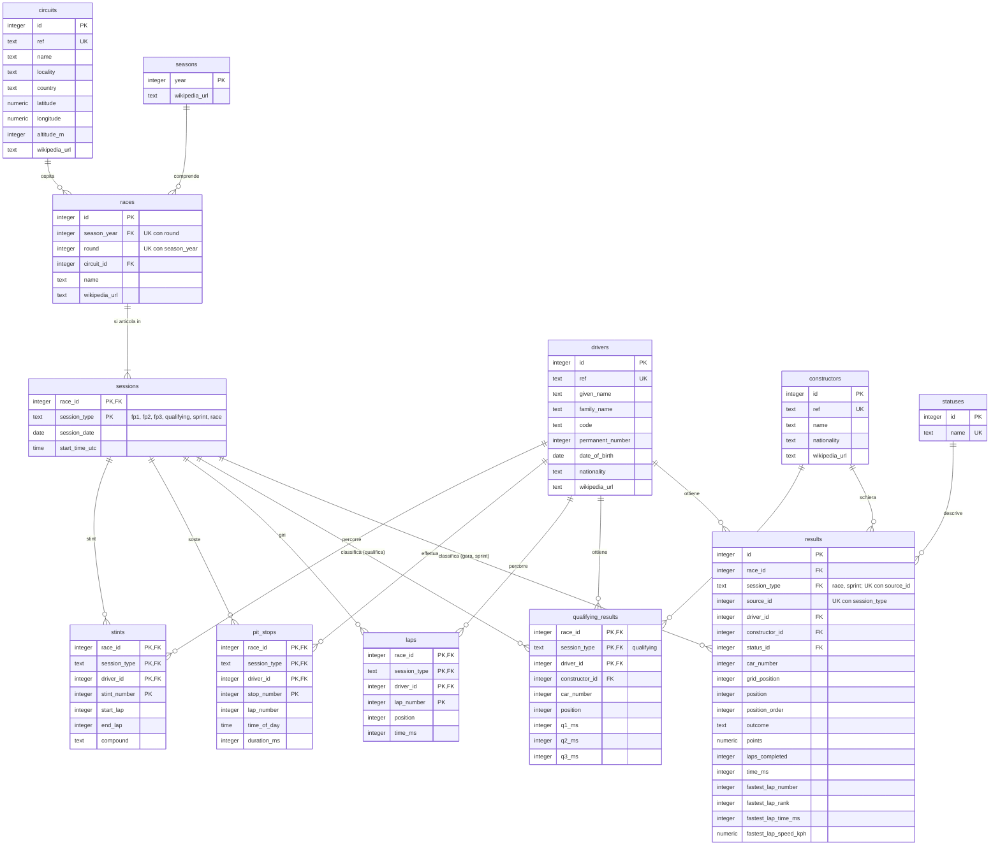

# Modello dati

Schema PostgreSQL 17 di F1 Data Platform. Nasce solo dalle migrazioni in `database/migrations/`:

| Migrazione | Contenuto |
|---|---|
| `V1__anagrafiche.sql` | `seasons`, `circuits`, `drivers`, `constructors`, `statuses` |
| `V2__gare_e_sessioni.sql` | `races`, `sessions` |
| `V3__risultati.sql` | `results`, `qualifying_results` |
| `V4__giri_soste_stint.sql` | `laps`, `pit_stops`, `stints` |

Il modello non ricalca i CSV Kaggle/Ergast. Le differenze principali:

- il weekend di gara è scomposto in **sessioni**, e classifiche, giri e soste si agganciano alla sessione, non alla gara;
- risultati di gara e di sprint stanno in **una sola tabella** (`results`), distinti dal tipo di sessione;
- tempi e durate sono **interi in millisecondi**; le colonne testuali ridondanti dei CSV (`time`, `duration`, `positionText`) non esistono;
- i valori "magici" della fonte (`\N`, griglia `0`) diventano `NULL`, e i vincoli `NOT NULL`/`CHECK` dichiarano che cosa è davvero obbligatorio;
- le classifiche di campionato, ricavabili dai risultati, non sono memorizzate.

## Diagramma ER



Le tabelle figlie di `sessions` la referenziano con la chiave esterna composta `(race_id, session_type)`.

## Tabelle

Per ogni tabella: significato di una riga, chiave primaria, chiave naturale, e **bersaglio dell'upsert** (la colonna o le colonne da usare in `ON CONFLICT`).

| Tabella | Una riga è | Chiave primaria | Chiave naturale (`UNIQUE`) | `ON CONFLICT` |
|---|---|---|---|---|
| `seasons` | una stagione | `year` | coincide con la primaria | `(year)` |
| `circuits` | un circuito | `id` | `ref` | `(id)` |
| `drivers` | un pilota | `id` | `ref` | `(id)` |
| `constructors` | una scuderia | `id` | `ref` | `(id)` |
| `statuses` | uno stato di arrivo | `id` | `name` | `(id)` |
| `races` | un Gran Premio (weekend) | `id` | `(season_year, round)` | `(id)` |
| `sessions` | una sessione del weekend | `(race_id, session_type)` | coincide con la primaria | primaria |
| `results` | una partecipazione pilota-vettura alla classifica di gara o sprint | `id` (identity) | `(session_type, source_id)` | `(session_type, source_id)` |
| `qualifying_results` | un pilota nella classifica di qualifica | `(race_id, session_type, driver_id)` | coincide con la primaria | primaria |
| `laps` | un giro cronometrato | `(race_id, session_type, driver_id, lap_number)` | coincide con la primaria | primaria |
| `pit_stops` | una sosta ai box | `(race_id, session_type, driver_id, stop_number)` | coincide con la primaria | primaria |
| `stints` | un tratto di gara tra due soste | `(race_id, session_type, driver_id, stint_number)` | primaria, più `(…, start_lap)` | sostituzione, vedi [Stint](#stint-e-mescole) |

Per le anagrafiche e per `races` il bersaglio dell'upsert è `id` e non la chiave naturale: se la fonte corregge uno slug o un round, la riga viene aggiornata invece di duplicarsi. La chiave naturale resta come guardia: un secondo `id` con lo stesso `ref` o lo stesso (stagione, round) fa fallire il caricamento in modo esplicito.

### Colonne obbligatorie e facoltative

Sono `NOT NULL` le chiavi e ciò senza cui la riga non ha significato o l'API non può rispondere. Tutto il resto è facoltativo perché nella fonte manca davvero per intere epoche.

| Tabella | Obbligatorie (oltre alle chiavi) | Facoltative e perché |
|---|---|---|
| `circuits` | `name`, `country` | `locality`, coordinate, `altitude_m` (assente per alcuni circuiti), `wikipedia_url` |
| `drivers` | `given_name`, `family_name` | `code` e `permanent_number` (assenti per i piloti storici), `date_of_birth`, `nationality` |
| `constructors` | `name` | `nationality` |
| `races` | `season_year`, `round`, `circuit_id`, `name` | `wikipedia_url` |
| `sessions` | `session_date` solo per `race` (vincolo `CHECK`) | `session_date` delle altre sessioni, `start_time_utc` |
| `results` | `driver_id`, `constructor_id`, `status_id`, `position_order`, `outcome`, `points`, `laps_completed` | `position` (solo classificati), `grid_position`, `car_number`, `time_ms` (solo a pieni giri), dati del giro veloce (dal 2004) |
| `qualifying_results` | `constructor_id`, `position` | `car_number`, `q1_ms`, `q2_ms`, `q3_ms` (un pilota eliminato in Q1 non ha Q2 e Q3) |
| `laps` | `time_ms` | `position` |
| `pit_stops` | `lap_number` | `time_of_day`, `duration_ms` |
| `stints` | `start_lap`, `end_lap` | `compound` (sempre `NULL` con questa fonte) |

## Sessioni

`races.csv` descrive il weekend con una riga sola e fino a dodici colonne di date e orari (`date`, `time`, `fp1_date`, … `sprint_time`). Nel modello ogni sessione è una riga di `sessions`, identificata da gara e tipo: `fp1`, `fp2`, `fp3`, `qualifying`, `sprint`, `race`.

**Quali righe esistono.** La pipeline crea:

1. sempre la sessione `race`, con `date` e `time` della gara;
2. una sessione `fp1`, `fp2`, `fp3`, `qualifying`, `sprint` quando la colonna `<sessione>_date` è valorizzata (in pratica dal 2021);
3. la sessione `qualifying` o `sprint` anche senza data, quando per quella gara esistono righe in `qualifying.csv` o `sprint_results.csv`. Succede per le qualifiche dal 1994 al 2020: i tempi ci sono, la data no. In quel caso `session_date` è `NULL`. Nel dataset completo riguarda 404 gare su 494 con qualifiche.

**A che livello si agganciano i dati.** Alla sessione:

| Tabella | Tipi di sessione ammessi | Con la fonte attuale |
|---|---|---|
| `results` | `race`, `sprint` | entrambi |
| `qualifying_results` | `qualifying` | `qualifying` |
| `laps` | qualsiasi | solo `race` |
| `pit_stops` | `race`, `sprint` | solo `race` |
| `stints` | `race`, `sprint` | solo `race` |

Motivi:

- **Una classifica appartiene a una sessione, non a un weekend.** Con le sprint lo stesso pilota ha due classifiche a punti nello stesso Gran Premio; agganciarle alla gara richiederebbe due tabelle gemelle (come nei CSV) o una colonna "è sprint" priva di integrità.
- **Il filtro per sessione della dashboard** diventa un filtro su una colonna: `WHERE race_id = ? AND session_type = ?`.
- **`laps` non limita il tipo di sessione** perché un giro cronometrato esiste in ogni sessione: una fonte futura con i giri di prove o sprint non richiede modifiche allo schema.

**Chiave composta invece di un `id` di sessione.** `sessions` ha come chiave primaria `(race_id, session_type)` e le figlie la ripetono. Conseguenze volute:

- ogni tabella di fatto ha `race_id` in chiaro: "risultati di una gara" e "giri di un pilota in una gara" si leggono senza join;
- la pipeline non deve chiedere al database un identificativo generato prima di caricare le figlie;
- i vincoli `CHECK (session_type IN (…))` sulle figlie esprimono quali sessioni producono quali dati.

Il costo è una colonna di testo breve in più per riga. `session_type` è `text` con `CHECK` e non un tipo `ENUM`: stesso controllo, nessun cast nelle query JDBC, e aggiungere un valore è una normale modifica di vincolo.

**La data della gara sta in `sessions`, non in `races`.** È la data della sessione `race`; tenerla anche in `races` la duplicherebbe. L'esistenza della sessione `race` per ogni gara non è esprimibile con un vincolo dichiarativo: la garantisce la pipeline, che genera `races` e `sessions` dalla stessa riga di `races.csv`. Il backend legge il calendario con un join sulla chiave primaria (vedi [Query dell'API](#query-dellapi)).

**Orari.** `start_time_utc` è di tipo `time` ed è in UTC, come nella fonte. Data e ora restano separate invece di un unico `timestamptz` perché l'orario manca per quasi tutte le stagioni storiche: un `timestamptz` costringerebbe a inventare la mezzanotte.

**Limite noto.** Le etichette `fp2` e `fp3` sono quelle della fonte. Nei weekend sprint il formato reale è diverso (la sprint shootout del 2023, ad esempio, occupa nella fonte una casella di prove libere): il modello non può distinguerla, perché il CSV non lo dice.

## Stint e mescole

Il dataset non contiene né le mescole né gli stint. Scelta: **`stints` è derivata dai pit stop, senza mescola.** Uno stint è il tratto percorso da un pilota tra due soste registrate. La colonna `compound` esiste, è sempre `NULL`, ed è pronta per una fonte che la fornisca.

Una tabella vuota non darebbe nulla alla vista "stint e pit stop" della dashboard, mentre la strategia di gara (quante soste, quanto è lungo ogni tratto) si ricava in modo affidabile dalle soste.

**Regola di derivazione** (la calcola la pipeline, in `transform`, e scrive `stints.parquet`):

- si derivano stint solo per le gare che hanno almeno una sosta in `pit_stops.csv` (dal 2011). Per le altre non si sa quando i piloti si sono fermati: nessuna riga, non uno stint unico fittizio;
- in quelle gare, per ogni pilota con almeno un giro completato (`results.laps_completed >= 1`): la fine di uno stint è il giro di una sosta, limitato all'ultimo giro completato; l'ultimo stint finisce all'ultimo giro completato;
- lo stint inizia al giro 1 o al giro successivo alla fine dello stint precedente;
- un pilota senza soste ha un solo stint, da 1 all'ultimo giro completato;
- due soste nello stesso giro, o una sosta nell'ultimo giro completato (ritiro ai box), non generano stint di lunghezza zero;
- un pilota con soste registrate ma nessun giro completato non ha stint: le sue soste restano in `pit_stops`. Nel dataset completo succede una volta (Hülkenberg, gara 1141). Chi legge soste e stint insieme non deve assumere che a ogni sosta corrisponda uno stint.

Specifica equivalente in SQL:

```sql
WITH gare_con_soste AS (
    SELECT DISTINCT race_id, session_type FROM pit_stops
), partecipanti AS (
    SELECT r.race_id, r.session_type, r.driver_id, max(r.laps_completed) AS ultimo_giro
    FROM results r JOIN gare_con_soste g USING (race_id, session_type)
    GROUP BY r.race_id, r.session_type, r.driver_id
    HAVING max(r.laps_completed) >= 1
), fine_stint AS (
    SELECT p.race_id, p.session_type, p.driver_id, least(s.lap_number, p.ultimo_giro) AS end_lap
    FROM partecipanti p JOIN pit_stops s USING (race_id, session_type, driver_id)
    UNION            -- elimina i giri di fine ripetuti
    SELECT race_id, session_type, driver_id, ultimo_giro FROM partecipanti
)
SELECT race_id, session_type, driver_id,
       row_number() OVER w                   AS stint_number,
       coalesce(lag(end_lap) OVER w, 0) + 1  AS start_lap,
       end_lap,
       NULL::text                            AS compound
FROM fine_stint
WINDOW w AS (PARTITION BY race_id, session_type, driver_id ORDER BY end_lap);
```

**Caricamento.** `stints` è un dato derivato: se cambiano le soste può cambiare il numero di stint, e un upsert lascerebbe righe orfane. Il caricamento sostituisce gli stint delle gare presenti nell'input (`DELETE` più `INSERT` nella stessa transazione). Il numero di righe resta identico a ogni riesecuzione.

**Limiti, da non nascondere.**

- Uno stint qui è "tratto tra due passaggi in pit lane", non "tratto con lo stesso treno di gomme": un drive-through registrato come sosta apre un nuovo stint, un cambio gomme in regime di bandiera rossa non registrato non lo apre.
- Si assume che `pit_stops.lap` sia il giro al termine del quale il pilota entra ai box.

**Cosa deve mostrare la dashboard.**

- Per ogni pilota: gli stint come segmenti numerati (giro iniziale, giro finale, numero di giri), con le soste e la loro durata. Nessun colore o nome di mescola.
- Una nota fissa accanto al grafico: le mescole non sono presenti nella fonte dati e gli stint sono ricavati dai pit stop.
- Per le gare senza soste registrate (prima del 2011): un messaggio "dati su stint e pit stop non disponibili per questa gara", non un grafico vuoto.

## Corrispondenza CSV → tabelle

Regole generali per la pipeline:

- `\N` e stringa vuota diventano `NULL`.
- I tempi testuali diventano millisecondi interi. Formati presenti: `m:ss.mmm` (giri, qualifiche, giro veloce), `ss.mmm` e `m:ss.mmm` (durata delle soste). Dove il CSV ha già la colonna `milliseconds`, quella è il valore caricato.
- Formato intermedio: **13 file Parquet per 12 tabelle**. Undici tabelle hanno un file con il proprio nome e le proprie colonne: `seasons`, `circuits`, `drivers`, `constructors`, `statuses`, `races`, `sessions`, `qualifying_results`, `laps`, `pit_stops`, `stints`. La tabella `results` è divisa in due file con le stesse colonne (quelle della tabella, senza `id`): `results.parquet` contiene solo i risultati delle gare (`session_type = 'race'`), `sprint_results.parquet` quelli delle sprint (`session_type = 'sprint'`). `load` li unisce nella tabella `results`. Motivo: un test di accettazione confronta il numero di righe di `results.parquet` con le righe valide di `results.csv`, quindi il file non può contenere anche le sprint.
- Ordine di caricamento: `seasons`, `circuits`, `drivers`, `constructors`, `statuses` → `races` → `sessions` → `results`, `qualifying_results`, `laps`, `pit_stops` → `stints`.

### `seasons.csv` → `seasons`

| CSV | Colonna | Note |
|---|---|---|
| `year` | `year` | |
| `url` | `wikipedia_url` | |

### `circuits.csv` → `circuits`

| CSV | Colonna | Note |
|---|---|---|
| `circuitId` | `id` | |
| `circuitRef` | `ref` | |
| `name` | `name` | |
| `location` | `locality` | |
| `country` | `country` | |
| `lat`, `lng` | `latitude`, `longitude` | gradi decimali |
| `alt` | `altitude_m` | metri; `\N` per alcuni circuiti |
| `url` | `wikipedia_url` | |

### `drivers.csv` → `drivers`

| CSV | Colonna | Note |
|---|---|---|
| `driverId` | `id` | |
| `driverRef` | `ref` | |
| `forename` | `given_name` | |
| `surname` | `family_name` | |
| `code` | `code` | `\N` per i piloti storici |
| `number` | `permanent_number` | `\N` per i piloti storici |
| `dob` | `date_of_birth` | |
| `nationality` | `nationality` | |
| `url` | `wikipedia_url` | |

### `constructors.csv` → `constructors`

`constructorId` → `id`, `constructorRef` → `ref`, `name`, `nationality`, `url` → `wikipedia_url`.

### `status.csv` → `statuses`

`statusId` → `id`, `status` → `name`.

### `races.csv` → `races` e `sessions`

| CSV | Tabella.colonna | Note |
|---|---|---|
| `raceId` | `races.id` | |
| `year` | `races.season_year` | deve esistere in `seasons` |
| `round` | `races.round` | |
| `circuitId` | `races.circuit_id` | |
| `name` | `races.name` | |
| `url` | `races.wikipedia_url` | |
| `date`, `time` | `sessions.session_date`, `sessions.start_time_utc` della sessione `race` | `date` obbligatoria: senza, la riga è uno scarto |
| `fp1_date`, `fp1_time` | sessione `fp1` | riga creata solo se la data è valorizzata |
| `fp2_date`, `fp2_time` | sessione `fp2` | come sopra |
| `fp3_date`, `fp3_time` | sessione `fp3` | come sopra |
| `quali_date`, `quali_time` | sessione `qualifying` | creata anche senza data se esistono qualifiche |
| `sprint_date`, `sprint_time` | sessione `sprint` | creata anche senza data se esistono risultati sprint |

### `results.csv` e `sprint_results.csv` → `results`

`session_type` vale `race` per `results.csv` e `sprint` per `sprint_results.csv`.

| CSV | Colonna | Note |
|---|---|---|
| `resultId` | `source_id` | chiave dell'upsert insieme a `session_type`; i duplicati si riconoscono su questa |
| `raceId` | `race_id` | |
| `driverId` | `driver_id` | |
| `constructorId` | `constructor_id` | |
| `statusId` | `status_id` | |
| `number` | `car_number` | |
| `grid` | `grid_position` | `0` → `NULL` (partenza dalla pit lane o non partito) |
| `position` | `position` | `\N` se non classificato; se manca con `positionText` numerico si deriva da quello |
| `positionOrder` | `position_order` | |
| `positionText` | `outcome` | intero positivo → `classified`; `R` → `retired`; `D` → `disqualified`; `E` → `excluded`; `W` → `withdrawn`; `F` → `failed_to_qualify`; `N` → `not_classified`. Altro valore: scarto. Vedi [Esito e posizione](#esito-e-posizione) |
| `points` | `points` | decimale (mezzi punti, punti divisi) |
| `laps` | `laps_completed` | |
| `milliseconds` | `time_ms` | |
| `time` | non caricata | testo ridondante: tempo del vincitore o distacco, ricavabile da `time_ms` |
| `fastestLap` | `fastest_lap_number` | |
| `rank` | `fastest_lap_rank` | `0` → `NULL`; assente in `sprint_results.csv` |
| `fastestLapTime` | `fastest_lap_time_ms` | da `m:ss.mmm` |
| `fastestLapSpeed` | `fastest_lap_speed_kph` | assente in `sprint_results.csv` |

`id` è generato dal database: la pipeline non lo valorizza.

#### Esito e posizione

Il vincolo `ck_results_outcome_position` chiede una posizione se e solo se l'esito è `classified`. `outcome` e `position` si ricavano insieme dalla coppia (`positionText`, `position`):

| `positionText` | `position` nel CSV | `outcome` | `position` caricata |
|---|---|---|---|
| intero positivo | intero positivo | `classified` | quella della colonna `position` |
| intero positivo | assente o non valida | `classified` | **derivata da `positionText`** |
| lettera nota (`R`, `D`, `E`, `W`, `F`, `N`) | assente | esito della lettera | `NULL` |
| lettera nota | valorizzata | scarto | |
| altro (lettera sconosciuta, `0`, vuoto) | qualsiasi | scarto | |

**Posizione derivata da `positionText`.** `positionText` è la fonte dell'esito: se è un numero, il pilota è classificato in quella posizione. Quando la colonna `position` manca, la pipeline la ricostruisce da `positionText`. Nel dataset completo succede per 2 righe su 26 759: `resultId` 1149 e 1152, gara 71 (Gran Premio d'Australia 2005), `positionText` e `positionOrder` 11 e 14, `position` = `\N`. Sono due piloti classificati a cui la fonte ha tolto solo la posizione numerica.

Alternative scartate:

- **Scartare le due righe.** Si perderebbero due risultati reali e, a cascata, i loro 111 giri: gli unici 113 scarti dell'intero dataset, per un dato che la riga stessa contiene in un'altra colonna.
- **Allentare il vincolo con una migrazione.** Ammettere `classified` senza posizione indebolirebbe la regola per tutte le 26 759 righe a causa di due, e ogni query che conta vittorie e podi con `position` dovrebbe chiedersi che cosa fare di un classificato senza posizione.

La derivazione non è un annullamento e non è uno scarto: `transform` la registra a parte (file, riga, valore derivato) e ne riporta il conteggio nel riepilogo. Se la colonna `position` è valorizzata ma non valida (non intera o non positiva), il valore originale finisce in `valori_annullati.json` e la posizione si deriva comunque da `positionText`.

Quando entrambe sono valorizzate vale la colonna `position`; `positionText` decide solo l'esito. La concordanza tra le due non è tra i controlli eseguiti alla tappa 3.

### `qualifying.csv` → `qualifying_results`

| CSV | Colonna | Note |
|---|---|---|
| `raceId` | `race_id` | `session_type` = `qualifying` |
| `driverId` | `driver_id` | |
| `constructorId` | `constructor_id` | |
| `number` | `car_number` | |
| `position` | `position` | |
| `q1`, `q2`, `q3` | `q1_ms`, `q2_ms`, `q3_ms` | da `m:ss.mmm`; `\N` o vuoto → `NULL` |
| `qualifyId` | non caricata | la chiave naturale (gara, pilota) basta |

### `lap_times.csv` → `laps`

| CSV | Colonna | Note |
|---|---|---|
| `raceId` | `race_id` | `session_type` = `race` |
| `driverId` | `driver_id` | |
| `lap` | `lap_number` | |
| `position` | `position` | |
| `milliseconds` | `time_ms` | obbligatorio |
| `time` | non caricata | testo ridondante |

### `pit_stops.csv` → `pit_stops`

| CSV | Colonna | Note |
|---|---|---|
| `raceId` | `race_id` | `session_type` = `race` |
| `driverId` | `driver_id` | |
| `stop` | `stop_number` | |
| `lap` | `lap_number` | |
| `time` | `time_of_day` | ora locale, `hh:mm:ss` |
| `milliseconds` | `duration_ms` | |
| `duration` | non caricata | testo ridondante |

### CSV non caricati

`driver_standings.csv`, `constructor_standings.csv`, `constructor_results.csv`: vedi [Cosa non è modellato](#cosa-non-è-modellato).

### Validazioni che lo schema si aspetta a monte

Il database rifiuta le righe che violano i vincoli; la pipeline deve intercettare ogni violazione prima, in `transform`, altrimenti il caricamento fallisce. `load` non deve mai fallire su un vincolo. Una violazione ha due esiti possibili, a seconda di dove cade.

**La riga si scarta** (registrata in `scarti.json` con file, riga e motivo) solo per:

- chiave mancante;
- tipo non valido, o valore fuori dai `CHECK`, su una chiave o su un campo obbligatorio (le colonne `NOT NULL` dello schema: vedi [Colonne obbligatorie e facoltative](#colonne-obbligatorie-e-facoltative));
- duplicato sulla chiave di caricamento: resta la prima riga valida;
- riferimento inesistente: la riga cita una gara, un pilota, una scuderia o uno stato che non esiste o che è stato scartato;
- cascata: un giro o una sosta di un pilota che non ha un risultato valido in quella gara. Lo schema non lo impone (vedi [Chiavi](#chiavi)), ma il test di coerenza conta i giri partendo dai piloti presenti nei risultati.

**L'attributo diventa `NULL` e la riga resta** (registrato in `valori_annullati.json` con file, riga, colonna, valore originale e motivo) quando un attributo facoltativo non è convertibile o è fuori dai `CHECK`: una durata di sosta non positiva, una sigla che non è di tre maiuscole, una latitudine fuori intervallo. Perdere un risultato o un giro per un attributo accessorio sbagliato toglierebbe più informazione di quanta ne protegga; il valore originale resta comunque rintracciabile nel registro.

Casi in cui la regola generale non basta:

- `positionText` e `position` si validano in coppia: vedi [Esito e posizione](#esito-e-posizione). `positionText` è un campo obbligatorio (da lui dipende `outcome`, `NOT NULL`): se è sconosciuto la riga è uno scarto;
- `grid = 0` e `rank = 0` sono il modo in cui la fonte scrive "assente": diventano `NULL` senza essere registrati come annullamenti;
- un orario di sessione senza la sua data viene annullato (`ck_sessions_time_needs_date`); la data della sessione `race` è obbligatoria, e senza di essa si scarta la riga di `races.csv`.

## Motivazioni

### Chiavi

**Anagrafiche e `races`: `id` intero ereditato dalla fonte, più chiave naturale `UNIQUE`.** `circuits`, `drivers`, `constructors`, `statuses` e `races` hanno un `id` intero che il database non genera: lo valorizza la pipeline con l'identificativo Ergast. Gli identificativi Ergast sono già chiavi surrogate (interi privi di significato), stabili tra una versione e l'altra del dataset. Generarne una seconda serie nel database aggiungerebbe una tabella di corrispondenza e una risoluzione delle chiavi a ogni caricamento, senza alcun vantaggio finché la fonte è una sola. In cambio si ottiene:

- **riproducibilità**: lo stesso input produce gli stessi `id` in qualunque database, quindi gli URL dell'API sono stabili e i valori attesi dei test si possono calcolare a mano;
- **caricamento semplice**: le chiavi esterne sono già risolte nei file intermedi.

Lo schema non dipende dal fatto che l'`id` venga da Ergast: è un intero opaco. Se arrivasse una seconda fonte, la chiave naturale (`ref`, stagione + round) è già dichiarata e permette di riconciliare.

**`seasons`: chiave naturale.** L'anno è stabile, breve e significativo: una chiave surrogata obbligherebbe a un join per leggere la stagione di una gara.

**`sessions`, `laps`, `pit_stops`, `stints`, `qualifying_results`: chiave primaria naturale composta.** Nessun'altra tabella le referenzia con una colonna singola, e la chiave naturale è esattamente l'indice che serve alle letture. Un `id` surrogato sarebbe un secondo indice su tabelle da centinaia di migliaia di righe (`laps`) senza alcun lettore.

**`results`: `id` generato più `(session_type, source_id)`.** È l'unica tabella in cui la chiave naturale "ovvia" non regge sul dataset storico: negli anni '50 un pilota poteva guidare più vetture nella stessa gara (vetture condivise), quindi (gara, pilota) non è univoca in `results.csv`. L'unico identificatore affidabile di una riga è quello della fonte, `resultId`. Non può essere la chiave primaria da solo perché `results.csv` e `sprint_results.csv` hanno numerazioni indipendenti: per questo è qualificato da `session_type`. L'`id` generato dà una chiave a colonna singola per eventuali tabelle future. L'upsert consuma valori della sequenza a ogni ricaricamento senza cambiare gli `id` esistenti; con circa 27 000 righe per caricamento completo il tipo `integer` basta per decine di migliaia di ricaricamenti.

Conseguenza: `laps` non ha una chiave esterna verso `results`. La coerenza "ogni giro appartiene a un pilota con un risultato" è una validazione della pipeline.

**Nessun `ON DELETE CASCADE`.** Il caricamento è fatto di upsert e non cancella (tranne la sostituzione di `stints`, che non ha figlie). Una cancellazione di una gara con dati collegati deve fallire, non propagarsi in silenzio.

### Normalizzazione

- **`results` unifica gare e sprint.** Stessa grana (un pilota-vettura in una classifica a punti), stesse colonne. Due tabelle gemelle obbligherebbero a `UNION` ogni volta che servono i punti di un weekend.
- **`qualifying_results` resta separata.** Ha attributi diversi (tre tempi, nessun punto, nessuno stato, nessun giro): fonderla in `results` produrrebbe una tabella con metà delle colonne sempre `NULL` a seconda del tipo.
- **`statuses` è una tabella.** Circa 140 descrizioni ripetute su ogni risultato; l'API le espone come testo con un join sulla chiave primaria.
- **`outcome` sostituisce `positionText`.** `positionText` mescola due informazioni: la posizione (già in `position`) e il motivo della mancata classifica (`R`, `D`, `E`, `W`, `F`, `N`). Resta solo la seconda, con valori leggibili, e il vincolo `ck_results_outcome_position` lega le due colonne: c'è una posizione se e solo se l'esito è `classified`. Il vincolo regge sull'intero dataset perché, nelle due righe in cui la fonte ha un `positionText` numerico senza `position`, la pipeline deriva la posizione da `positionText` (vedi [Esito e posizione](#esito-e-posizione)).
- **`grid_position` è `NULL` invece di `0`.** Nella fonte `0` significa "nessuna casella". Con `NULL` una media o un minimo sulla griglia non vengono falsati.
- **`position_order` è mantenuta.** Ordina anche i non classificati; non è ricavabile da `position`.
- **Dati del giro veloce in `results`.** `fastest_lap_time_ms` è in teoria ricavabile da `laps`, ma è il dato ufficiale della fonte, esiste anche dove i giri mancano, e rango e velocità non sono ricavabili. È una ridondanza accettata e limitata a una colonna.
- **Paesi e nazionalità restano testo.** `circuits.country` è un nome di paese, `nationality` un aggettivo ("British"): due vocabolari diversi. Una tabella dei paesi richiederebbe una mappatura curata a mano che la fonte non fornisce.
- **Nessuna colonna calcolata memorizzata.** Numero di giri di uno stint, distacco dal vincitore, nome completo del pilota si calcolano in lettura.

### Tipi

- **Tempi e durate: `integer` in millisecondi.** La precisione della fonte è il millisecondo; un intero è esatto, occupa 4 byte (un `interval` ne occupa 16), si aggrega con `avg`/`min` senza conversioni e coincide con il contratto dell'API (`timeMs`). Il massimo di `integer` equivale a quasi 25 giorni.
- **Orari: `time`**, senza data, per l'inizio delle sessioni (UTC) e per l'ora della sosta (locale).
- **`points`: `numeric(6,2)`.** Esistono mezzi punti e punti frazionati nelle vetture condivise; un tipo in virgola mobile darebbe somme non esatte.
- **Identificativi e contatori: `integer`.** `smallint` farebbe risparmiare pochi byte in cambio di conversioni nel backend.
- **Testo: `text`** con `CHECK` dove serve, non `varchar(n)`: in PostgreSQL non c'è differenza di prestazioni e le lunghezze sarebbero arbitrarie.
- **`drivers.code` non è univoco.** Piloti diversi condividono la stessa sigla (padri e figli, ad esempio): un vincolo `UNIQUE` farebbe fallire il dataset completo.

### Indici

Ogni chiave primaria e ogni vincolo `UNIQUE` ha già il suo indice. Quelli aggiunti:

| Indice | Serve a |
|---|---|
| `idx_results_session_order (race_id, session_type, position_order)` | classifica di una gara già ordinata: `GET /api/races/{raceId}/results` |
| `idx_results_driver (driver_id, session_type, race_id)` | statistiche di un pilota, piloti di una stagione |
| `idx_results_constructor (constructor_id, session_type, race_id)` | statistiche di una scuderia |
| `idx_races_circuit (circuit_id)` | gare su un circuito, chiave esterna |

Indici impliciti che servono l'API:

| Indice | Serve a |
|---|---|
| `uq_races_season_round (season_year, round)` | gare di una stagione in ordine di round; filtro per stagione nelle statistiche |
| `pk_sessions (race_id, session_type)` | data della gara, sessioni di un weekend |
| `pk_laps (race_id, session_type, driver_id, lap_number)` | giri di un pilota in una gara, già ordinati; tutti i giri di una gara per il grafico delle posizioni |
| `pk_pit_stops`, `pk_stints` | soste e stint di una gara o di un pilota in una gara |

**Indici non creati, di proposito.** Nessun indice su `laps.driver_id`, `pit_stops.driver_id`, `stints.driver_id`, `qualifying_results.driver_id`, `qualifying_results.constructor_id`, `results.status_id`. Nessuna query dell'API parte da lì, e le tabelle padre non subiscono cancellazioni che richiedano di cercare le figlie. Su `laps` un indice in più costerebbe a ogni caricamento. Se una query futura ne avesse bisogno, si aggiunge con una nuova migrazione.

### Query dell'API

Forma delle query previste, per verificare che lo schema le serva senza giri complicati.

```sql
-- GET /api/seasons/{year}/races
SELECT r.id, r.round, r.name, s.session_date AS date
FROM races r
JOIN sessions s ON s.race_id = r.id AND s.session_type = 'race'
WHERE r.season_year = :year
ORDER BY r.round;

-- GET /api/races/{raceId}/results
SELECT res.position, res.points, st.name AS status, res.laps_completed AS laps,
       d.id, d.code, d.given_name, d.family_name, c.id, c.name
FROM results res
JOIN drivers d ON d.id = res.driver_id
JOIN constructors c ON c.id = res.constructor_id
JOIN statuses st ON st.id = res.status_id
WHERE res.race_id = :raceId AND res.session_type = 'race'
ORDER BY res.position_order;

-- GET /api/races/{raceId}/laps/{driverId}
SELECT lap_number AS lap, position, time_ms
FROM laps
WHERE race_id = :raceId AND session_type = 'race' AND driver_id = :driverId
ORDER BY lap_number;

-- GET /api/drivers/{driverId}/statistics[?season=YYYY]
SELECT count(DISTINCT res.race_id)                              AS races,
       count(DISTINCT res.race_id) FILTER (WHERE res.position = 1)  AS wins,
       count(DISTINCT res.race_id) FILTER (WHERE res.position <= 3) AS podiums,
       coalesce(sum(res.points), 0)                             AS points
FROM results res
JOIN races r ON r.id = res.race_id
WHERE res.driver_id = :driverId
  AND res.session_type = 'race'
  AND (CAST(:season AS integer) IS NULL OR r.season_year = :season);

-- GET /api/teams/{teamId}/statistics[?season=YYYY]
SELECT count(DISTINCT res.race_id)                              AS races,
       count(DISTINCT res.race_id) FILTER (WHERE res.position = 1)  AS wins,
       count(DISTINCT (res.race_id, res.position))
           FILTER (WHERE res.position <= 3)                     AS podiums,
       coalesce(sum(res.points), 0)                             AS points
FROM results res
JOIN races r ON r.id = res.race_id
WHERE res.constructor_id = :teamId
  AND res.session_type = 'race'
  AND (CAST(:season AS integer) IS NULL OR r.season_year = :season);
```

La query di scuderia usa `idx_results_constructor (constructor_id, session_type, race_id)` e la chiave primaria di `races`.

**Podi di una scuderia: due definizioni.** Una scuderia schiera più vetture, quindi "podi" può voler dire due cose diverse:

| Definizione | Espressione | Red Bull 2023 |
|---|---|---|
| Gare con almeno un podio | `count(DISTINCT race_id) FILTER (WHERE position <= 3)` | 21 |
| Piazzamenti a podio | `count(DISTINCT (race_id, position)) FILTER (WHERE position <= 3)` | 30 |

Le vittorie non hanno questa ambiguità: il primo posto è uno solo per gara, e per Red Bull nel 2023 sono 21 in entrambi i modi.

Raccomandazione: esporre come `podiums` i **piazzamenti a podio** (30). Motivi:

- è il significato corrente di "podi di una scuderia": due vetture sul podio nella stessa gara sono due podi;
- l'altra definizione non può superare il numero di gare e nasconde proprio i doppi podi, cioè l'informazione che distingue una scuderia da un pilota;
- per un pilota le due definizioni coincidono, quindi il campo ha lo stesso significato nei due endpoint: "piazzamenti tra i primi tre".

La scelta resta al backend, che la dichiara nella documentazione OpenAPI. Il test di accettazione fissa per la scuderia solo `wins`. Conseguenza da documentare se si segue la raccomandazione: per una scuderia `podiums` può superare `races`.

`count(DISTINCT (race_id, position))` e non `count(*)`: con le vetture condivise degli anni '50 due piloti della stessa scuderia hanno ciascuno una riga con la stessa posizione per la stessa vettura, e `count(*)` conterebbe due podi per un solo gradino.

Note per il backend:

- `count(DISTINCT race_id)` e non `count(*)`: nelle stagioni storiche un pilota può avere più righe nella stessa gara (91 coppie gara-pilota ripetute in `results.csv`), e una scuderia ne ha sempre più di una.
- Le statistiche contano le sole sessioni `race` (Gran Premi), come i valori attesi dei test. Se i punti debbano includere le sprint è una scelta di prodotto del backend: i dati ci sono (`session_type = 'sprint'`).
- `sum(points)` è la somma dei punti segnati. In alcune stagioni storiche il totale ufficiale di campionato è diverso (regola dei migliori risultati): il modello non contiene le classifiche ufficiali.
- La sessione `race` esiste per ogni gara per costruzione della pipeline, non per vincolo: chi vuole essere difensivo usa `LEFT JOIN`.

### Migrazioni: Flyway, applicate dal backend

Scelta **confermata**. Il backend applica all'avvio le migrazioni di `database/migrations/`, impacchettate nel jar; la pipeline carica su un database già migrato.

- Lo schema ha un solo proprietario, ed è il componente le cui query dipendono dallo schema: codice dell'API e migrazioni vengono rilasciati insieme.
- La pipeline resta un caricatore: non porta con sé uno strumento di migrazione né una seconda copia dello schema.
- Il prezzo è un ordine di avvio: prima il backend, poi la pipeline. Nel Compose è già espresso (`pipeline` parte quando `backend` è healthy). Fuori dal Compose la pipeline deve fallire con un messaggio chiaro se le tabelle non esistono, non provare a crearle.

Regole:

- una migrazione applicata non si modifica (Flyway ne verifica il checksum): ogni cambiamento è un nuovo file `V<n>__<descrizione>.sql`;
- nessuna modifica allo schema fuori dalle migrazioni, nemmeno nei test;
- i file non usano la sintassi dei segnaposto di Flyway.

## Cosa non è modellato

| Cosa | Perché |
|---|---|
| Classifiche di campionato (`driver_standings.csv`, `constructor_standings.csv`) | Si ricavano dai risultati; memorizzarle ripeterebbe gli stessi punti. Limite: per le stagioni con la regola dei migliori risultati il totale ufficiale non coincide con la somma |
| `constructor_results.csv` | È la somma per scuderia dei punti di `results` |
| Mescole | Assenti dalla fonte; `stints.compound` è predisposta |
| Sessione e risultati della sprint shootout | Assenti dalla fonte |
| Tempi di prove libere, telemetria, meteo | Assenti dalla fonte |
| Rapporto pilota-scuderia per stagione | Si ricava da `results`; un pilota può cambiare scuderia a stagione in corso, quindi il dato corretto è per gara, ed è già lì |
| Tabella dei paesi | Vedi [Normalizzazione](#normalizzazione) |
| Storico delle modifiche e colonne di audit (`created_at`, `updated_at`) | La pipeline è riproducibile dall'input: lo stato del database è una funzione dei CSV. Colonne con l'ora di caricamento renderebbero diverse due esecuzioni identiche |

## Assunzioni sulla fonte: esito della verifica

Lo schema è stato progettato senza i CSV nel repository, sulla struttura nota del dataset. Le assunzioni sono state verificate il **2026-11-10**, alla tappa 3, eseguendo la pipeline sul dataset completo (1950–2024) e sul campione (2022–2024) con le migrazioni V1–V4 invariate.

Risultato: nel campione 2022–2024 nessuna violazione. Nel dataset completo una sola assunzione non regge, per 2 righe su 26 759, ed è risolta con una regola di trasformazione, senza migrazioni.

| # | Assunzione | Esito sul dataset completo |
|---|---|---|
| 1a | `positionText` contiene solo numeri e le lettere `R`, `D`, `E`, `W`, `F`, `N` | Regge |
| 1b | `positionText` è numerico esattamente quando `position` è valorizzata | **Non regge**: 2 righe su 26 759 (`resultId` 1149 e 1152, gara 71, Gran Premio d'Australia 2005) hanno `positionText` 11 e 14 e `position` = `\N`. Il caso inverso (lettera con `position` valorizzata) non si presenta. Regola: [Esito e posizione](#esito-e-posizione) |
| 2 | `rank` e `grid` usano `0` per "assente"; `fastestLap` non è mai `0` | Regge: `grid = 0` in 1638 righe, `rank = 0` in 258, `fastestLap` mai `0` |
| 3 | `sprint_results.csv` ha le colonne di `results.csv` tranne `rank` e `fastestLapSpeed` | Regge |
| 4 | (gara, pilota) è univoca in `qualifying.csv`, (gara, pilota, giro) in `lap_times.csv`, (gara, pilota, sosta) in `pit_stops.csv` | Regge: 0 duplicati |
| 5 | `qualifying.position` è sempre valorizzata; `lap_times.milliseconds` è sempre valorizzata e positiva | Regge |
| 6 | Le sigle dei piloti sono tre caratteri maiuscoli; i numeri permanenti stanno tra 0 e 99 | Regge. 757 piloti su 861 non hanno sigla |
| 7 | `circuits.country`, `drivers.forename` e `drivers.surname` non sono mai vuoti | Regge |
| 8 | `pit_stops.time` è l'ora locale e `pit_stops.lap` è il giro di ingresso ai box | **Non verificabile dai dati** |
| 9 | Gli orari di `races.csv` sono in UTC | **Non verificabile dai dati** |
| 10 | `statuses.name` e i `ref` sono univoci | Regge |

Tutti gli altri vincoli `CHECK`, `NOT NULL`, `UNIQUE` e le chiavi esterne: 0 violazioni. Ogni giro e ogni sosta appartiene a un pilota con un risultato in quella gara.

**Assunzioni non verificabili (8 e 9).** I CSV non contengono nulla con cui confrontarle; restano assunzioni dichiarate, basate sulla documentazione della fonte. Se la 8 fosse falsa cambierebbero di un giro i confini degli stint e il significato di `pit_stops.time_of_day`; se lo fosse la 9, il nome e il significato di `sessions.start_time_utc`. Nessuna delle due tocca vincoli o chiavi.

**Scarti prima e dopo la regola.** Con la regola precedente ("numerico con `position` assente: scarto") le due righe del 2005 venivano scartate insieme ai loro 111 giri di `lap_times.csv`: 113 scarti, gli unici dell'intero dataset. Con la posizione derivata da `positionText` gli scarti attesi sul dataset completo sono zero; il valore va confermato rieseguendo `transform` dopo la modifica.

**Osservazioni che confermano scelte già prese.**

- (gara, pilota) è ripetuta 91 volte in `results.csv` (vetture condivise): conferma l'assenza di un `UNIQUE` su quella coppia e l'uso di `(session_type, source_id)` come chiave di caricamento.
- 6 risultati non hanno numero di vettura: `results.car_number` resta facoltativa.
- 404 gare su 494 con qualifiche non hanno `quali_date`: la sessione `qualifying` viene creata senza data, come previsto in [Sessioni](#sessioni).
- Un pilota con soste registrate e 0 giri completati non ha stint (Hülkenberg, gara 1141): è l'effetto voluto della condizione `laps_completed >= 1`, vedi [Stint e mescole](#stint-e-mescole).

Una nuova versione del dataset può violare un'assunzione che oggi regge. La pipeline non la lascia arrivare al database: la riga finisce in `scarti.json` o l'attributo in `valori_annullati.json`, e i conteggi del riepilogo di `transform` lo rendono visibile.
